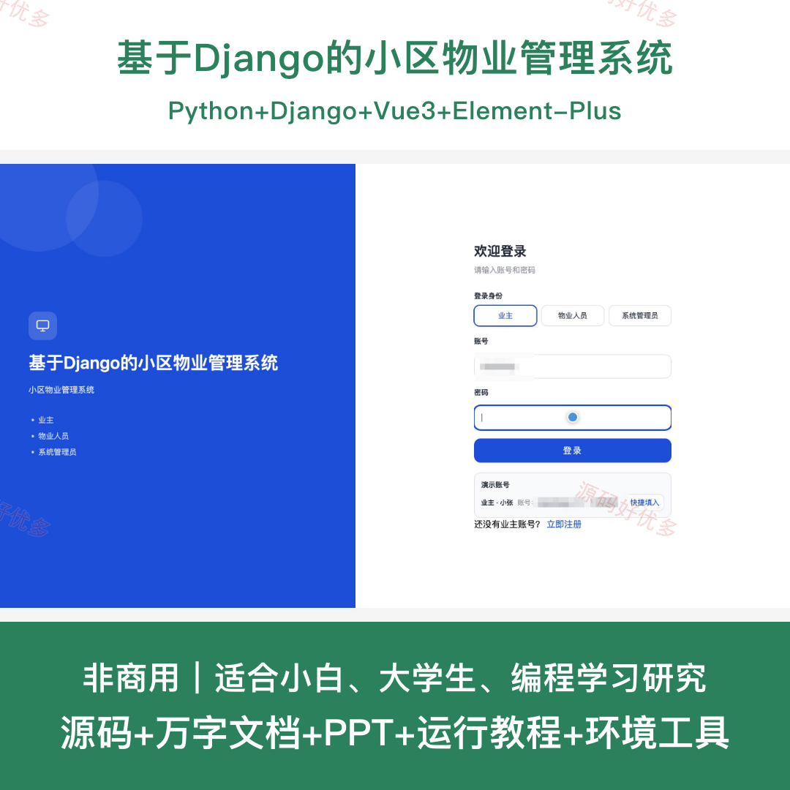
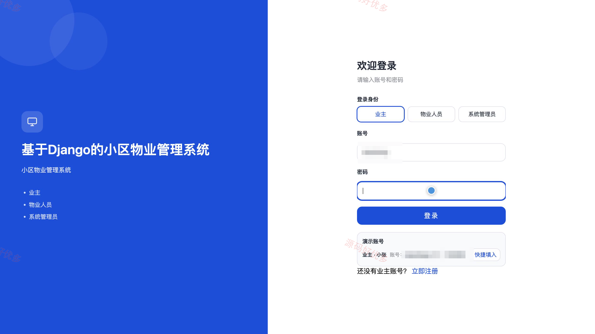
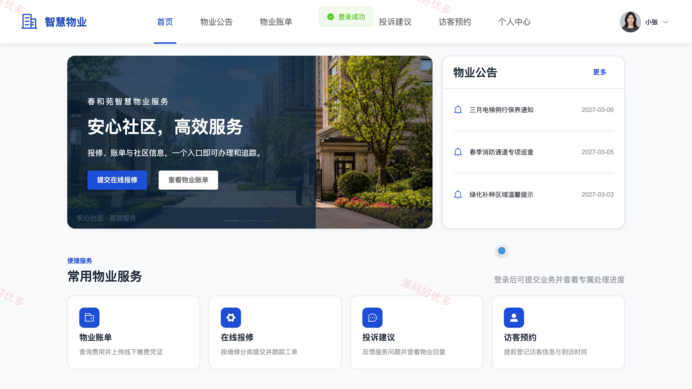
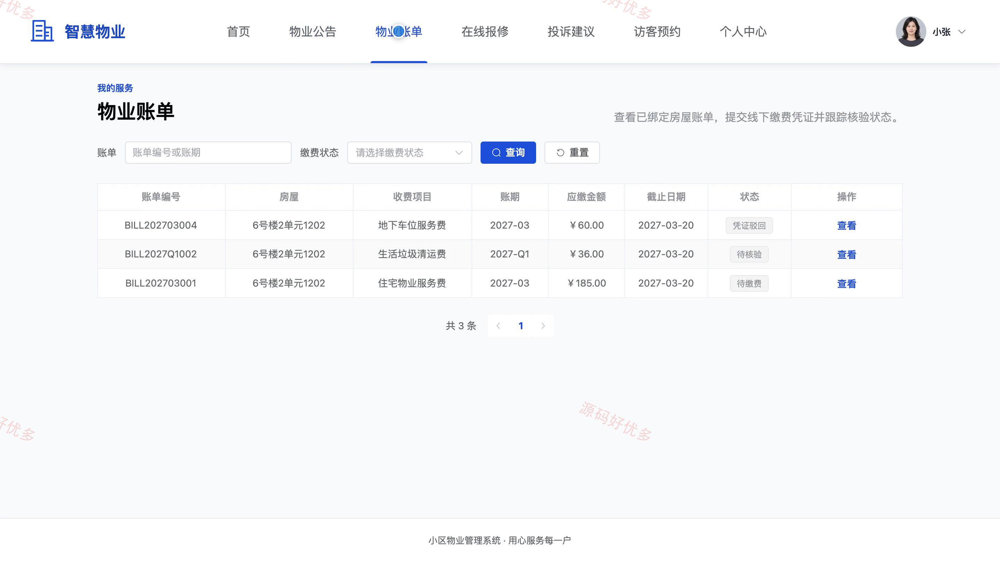
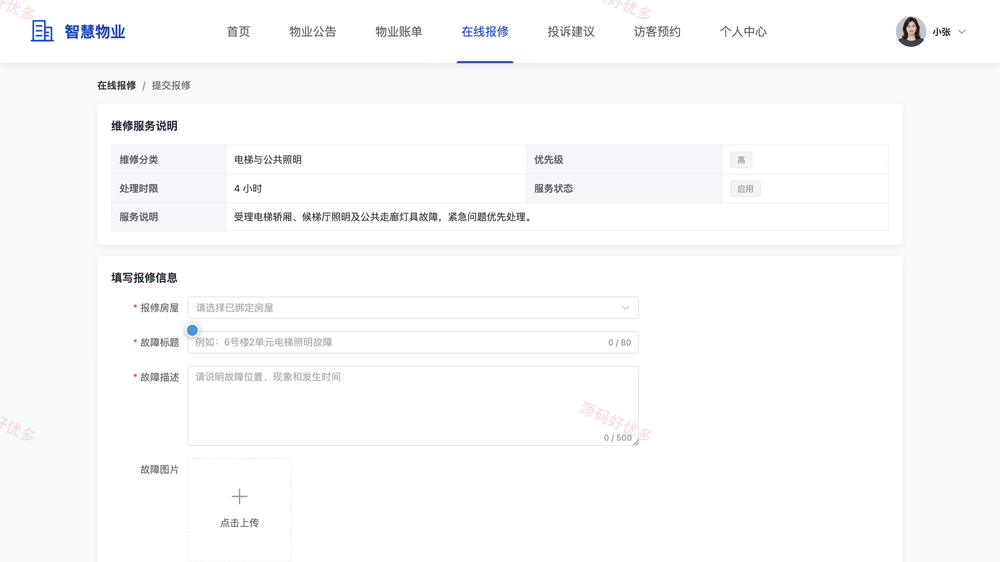
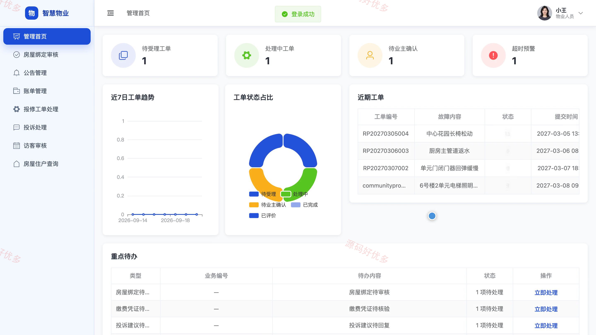
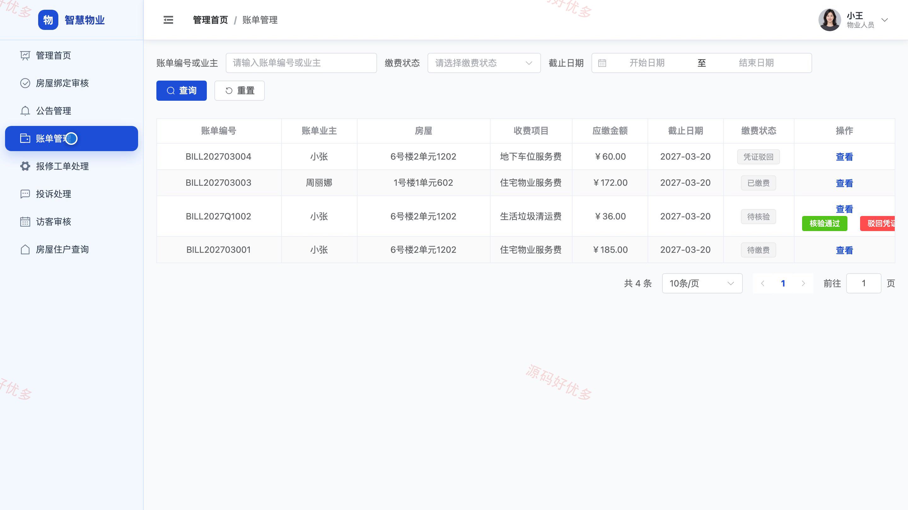
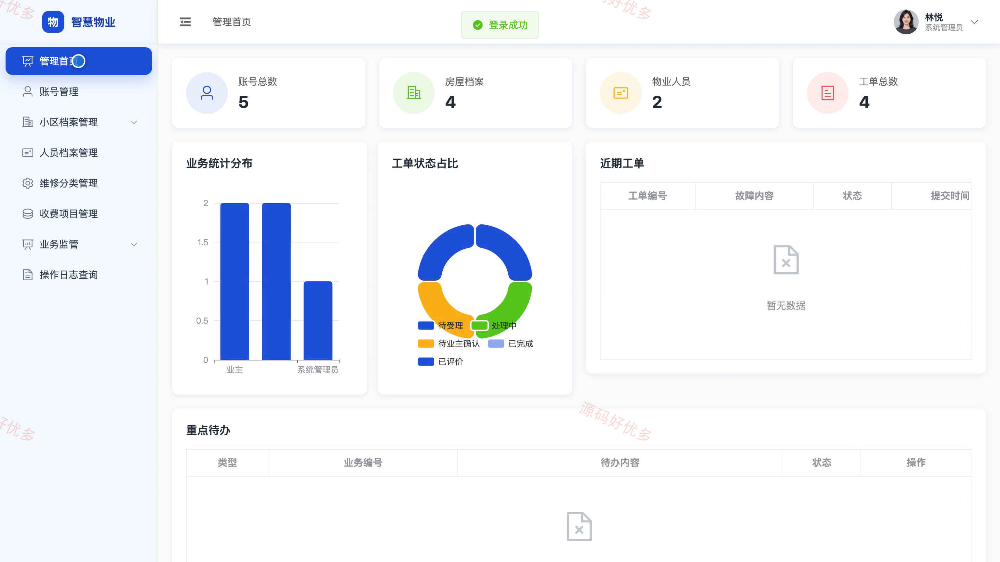
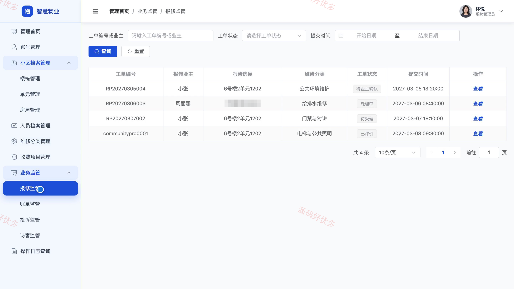

# bs031C
bs031C基于Django的小区物业管理系统源码 Python Django Vue3 前后分离
## 源码问题查看主页咨询

### 一、关键词
智慧物业、小区服务、在线报修、物业缴费、访客预约

### 二、作品包含
源码+数据库+万字设计文档+PPT+全套环境和工具资源+本地部署教程

### 三、项目技术
前端技术： Html、Css、Js、Vue3.4、Element-Plus
后端技术：Python、Django

### 四、运行环境要求
开发工具：PyCharm + VSCODE

数据库：MySQL5.7+（共18张表）

数据库管理工具：Navicat10以上版本

环境配置软件： Python3.9+

前端Nodejs：16+

浏览器：谷歌浏览器

### 五、项目介绍
项目编号：bs031C

本系统面向业主、物业人员与系统管理员，覆盖小区档案、房屋绑定、物业账单、在线报修、投诉处理和访客预约等业务，实现住户服务、物业处置与后台监管的协同管理。

角色：业主、物业人员、系统管理员

业主功能：查看物业公告、查询物业账单、上传缴费凭证、提交与跟踪报修、评价报修服务、申请绑定房屋、提交投诉建议、提交访客预约。

物业人员功能：审核房屋绑定、管理物业公告、管理账单与核验缴费、受理与处理报修工单、回复投诉建议、审核访客预约、查询房屋住户、维护个人资料。

系统管理员功能：管理系统账号、管理楼栋单元与房屋档案、管理物业人员档案、管理维修分类、管理收费项目、监管报修账单投诉与访客业务、查询操作日志、查看管理统计。

### 六、运行截图

